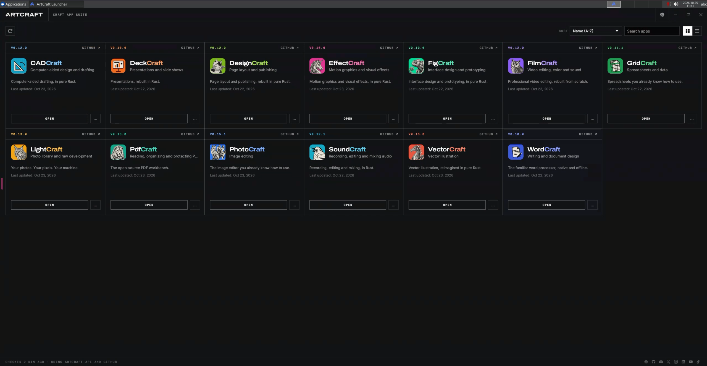
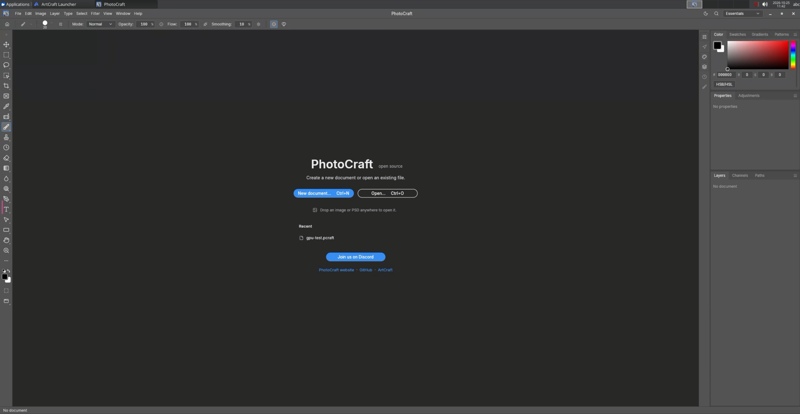

# ArtCraft in Docker

ArtCraft Launcher and 13 Craft App Suite applications in a single container,
accessible through a web browser. The suite includes tools for photography,
graphics, video editing, visual effects, audio, documents, and design.
Applications run on the server, use its GPU, and share a project directory.

This repository contains Docker Compose, a Dockerfile, and setup scripts.
Compose uses the ready-to-run [60plus/artcraft](https://hub.docker.com/r/60plus/artcraft)
image from Docker Hub. All 13 applications and the launcher are already installed.
There is no need to build the image or compile the applications.

## Screenshots

**ArtCraft Launcher** with all 13 applications installed.



**PhotoCraft** running in the container's desktop.



## Applications

[ArtCraft Launcher](https://github.com/storytold/craft-launcher) opens when the
desktop starts. Use it to select an application:

Official application previews from [ArtCraft](https://getartcraft.com/apps). Click a preview to visit the application page.

| Preview | Application | Purpose |
| --- | --- | --- |
| <a href="https://getartcraft.com/apps/photocraft"></a> | [PhotoCraft](https://getartcraft.com/apps/photocraft) | Image editing, layers, and masks |
| <a href="https://getartcraft.com/apps/lightcraft"></a> | [LightCraft](https://getartcraft.com/apps/lightcraft) | Photo library management and RAW development |
| <a href="https://getartcraft.com/apps/vectorcraft"></a> | [VectorCraft](https://getartcraft.com/apps/vectorcraft) | Vector graphics |
| <a href="https://getartcraft.com/apps/filmcraft"></a> | [FilmCraft](https://getartcraft.com/apps/filmcraft) | Video editing, color, and sound |
| <a href="https://getartcraft.com/apps/effectcraft"></a> | [EffectCraft](https://getartcraft.com/apps/effectcraft) | Motion graphics and visual effects |
| <a href="https://getartcraft.com/apps/soundcraft"></a> | [SoundCraft](https://getartcraft.com/apps/soundcraft) | Audio recording and editing |
| <a href="https://getartcraft.com/apps/designcraft"></a> | [DesignCraft](https://getartcraft.com/apps/designcraft) | Page layout and publishing |
| <a href="https://getartcraft.com/apps/figcraft"></a> | [FigCraft](https://getartcraft.com/apps/figcraft) | Interface design and prototyping |
| <a href="https://getartcraft.com/apps/pdfcraft"></a> | [PdfCraft](https://getartcraft.com/apps/pdfcraft) | PDF viewing and organization |
| <a href="https://getartcraft.com/apps/wordcraft"></a> | [WordCraft](https://getartcraft.com/apps/wordcraft) | Word processing |
| <a href="https://getartcraft.com/apps/deckcraft"></a> | [DeckCraft](https://getartcraft.com/apps/deckcraft) | Presentations |
| <a href="https://getartcraft.com/apps/gridcraft"></a> | [GridCraft](https://getartcraft.com/apps/gridcraft) | Spreadsheets |
| <a href="https://getartcraft.com/apps/cadcraft"></a> | [CADCraft](https://getartcraft.com/apps/cadcraft) | Computer-aided design |

The selection follows the [Craft App Suite](https://github.com/storytold/craft-launcher#the-craft-app-suite).
The separate [ArtCraft](https://github.com/storytold/artcraft) project provides
AI image and video creation with 2D and 3D scene composition. This configuration
includes the launcher and the editors listed above; it does not install the
ArtCraft AI studio or its backend.

## Requirements

- A Linux x86_64 server with an NVIDIA GPU and a working driver.
- Docker Engine and Docker Compose with support for `gpus: all`.
- NVIDIA Container Toolkit configured for Docker.
- Available `/dev/dri` and `/dev/nvidia-modeset` devices.
- Python 3 to prepare the data directories.
- Internet access to download the image from Docker Hub.

The browser can run on another computer. Application acceleration and video
encoding take place on the server. The supplied Compose configuration targets
NVIDIA GPUs. AMD, Intel, and CPU-only setups require separate configuration.

## Getting started

Clone this repository or extract its archive, then open the directory containing
`compose.yaml`.

```sh
cp .env.example .env
```

Edit `.env`. Set your own `PASSWORD`, data paths, and the `PUID` and `PGID`
of the user who should own the files on the host. Run `id -u` and `id -g`
as that user to find these IDs.

The default `BIND_ADDRESS=127.0.0.1` makes the desktop accessible only on the
server itself. To connect from another computer, set `BIND_ADDRESS` to the
server's local network address.

```sh
sudo python3 scripts/prepare-host.py
sudo nvidia-modprobe --modeset
docker compose pull
docker compose up -d
```

The setup script creates missing directories using the paths and ownership
specified in `.env`. It does not change ownership of existing directories;
these must already allow writes by the configured `PUID` and `PGID`.
If `.env` does not exist, the script creates it from the template and generates
a random password. Compose downloads the image with all applications included.

Open `https://localhost:3443` on the server or `https://SERVER_ADDRESS:3443`
from another computer. Sign in using `CUSTOM_USER` and `PASSWORD` from `.env`.
The desktop uses a local certificate by default, so your browser may display
a certificate warning on the first connection.

## Application data and projects

Both directories use bind mounts. You can select a separate disk, an existing
host directory, or a path relative to `compose.yaml`.

Example `.env` settings:

```dotenv
APP_DATA_DIR=/srv/artcraft/config
PROJECTS_DIR=/srv/artcraft/projects
PUID=1000
PGID=1000
```

| Variable | Default host path | Container path | Contents |
| --- | --- | --- | --- |
| `APP_DATA_DIR` | `./data/config` | `/config` | Application settings, profiles, and desktop files |
| `PROJECTS_DIR` | `./data/projects` | `/projects` | Shared projects and assets |

All applications can access `/projects`. The desktop shortcut and file chooser
bookmark named **Wspólne projekty** (Shared projects) point to this directory,
as does the system Documents location. You can also enter `/projects`
directly in a file chooser.

Upload files from your computer through **Files > Upload** in the sidebar,
or drag them onto the remote desktop area. Uploaded files appear on the
container's desktop. Move them into the shared projects directory from there.

A file saved in one application can be opened in another if it supports that
format. Use export and import when necessary. Changes are not automatically
merged between open documents. Data in both host directories survives container
recreation.

Changing a path in `.env` does not move existing data. Save your documents,
stop the container, and copy the contents to the new directory while preserving
permissions before starting it again. Back up both directories.

## Other settings

| Variable in `.env` | Purpose | Default |
| --- | --- | --- |
| `BIND_ADDRESS` | Host interface address for the desktop | `127.0.0.1` |
| `HTTPS_PORT` | HTTPS port | `3443` |
| `CUSTOM_USER` | Desktop login | `craft` |
| `PASSWORD` | Desktop password | Must be configured |
| `TZ` | Desktop time zone | `Etc/UTC` |
| `CRAFT_APP` | Application launched at startup | `artcraft-launcher` |
| `ARTCRAFT_IMAGE` | Image to download and run | `60plus/artcraft:latest` |

For example, `CRAFT_APP=photocraft` opens PhotoCraft directly.
Other applications remain available from the desktop menu. Run
`docker compose up -d` after changing the configuration.
Save open documents before recreating the container.

## Operation and updates

```sh
docker compose ps
docker compose logs --tail 100 desktop
docker compose stop
docker compose up -d
```

To download and run the latest published image, save open documents and run:

```sh
docker compose pull
docker compose up -d
```

The container is recreated when the image changes. Settings and projects remain
in the configured bind mounts. To use a specific published version, set
`ARTCRAFT_IMAGE=60plus/artcraft:0.7.0` in `.env` before pulling.

Updates made through the launcher modify the running container and may be lost
when it is recreated. Published images include the application versions recorded
in `releases.lock.json`.

The container is configured to restart automatically. The optional
`craft-suite.service` also loads the NVIDIA modeset module before starting
Compose. Adjust its `WorkingDirectory` to match the repository location
before installing the service.

## Building your own image

Application versions, package URLs, and SHA-256 checksums are recorded in
`releases.lock.json`. Update this file to change the bundled versions, then build:

```sh
docker build -t artcraft:local .
```

Set `ARTCRAFT_IMAGE=artcraft:local` in `.env` and run `docker compose up -d`.
Skip `docker compose pull` when using your own local image. The Dockerfile pins
the base image by digest and checks the downloaded application packages.
Rebuilding alone does not select newer application releases.

## Sources

- [ArtCraft](https://github.com/storytold/artcraft)
- [ArtCraft Launcher and Craft App Suite](https://github.com/storytold/craft-launcher)
- [LinuxServer Webtop](https://docs.linuxserver.io/images/docker-webtop/)
- [Selkies: desktop controls and file transfers](https://docs.linuxserver.io/selkies/user-guide/web-client/)
- [NVIDIA Container Toolkit](https://docs.nvidia.com/datacenter/cloud-native/container-toolkit/latest/install-guide.html)
